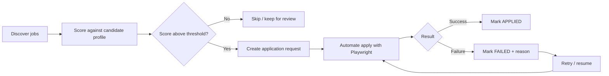

# Job Application Automation

A Spring Boot application that discovers relevant job opportunities, scores them against candidate profiles, and manages or automates applications across supported job platforms.

Every candidate and every application request is stored in a database, so you always know **who applied where, with what, and what happened**.

---

## Table of Contents

- [Features](#features)
- [How It Works](#how-it-works)
- [Tech Stack](#tech-stack)
- [Getting Started](#getting-started)
- [Configuration](#configuration)
- [Database and H2 Console](#database-and-h2-console)
- [Monitoring with Actuator](#monitoring-with-actuator)
- [Browser Automation](#browser-automation)
- [Project Structure](#project-structure)
- [API Overview](#api-overview)
- [Adding a New Platform](#adding-a-new-platform)
- [Troubleshooting](#troubleshooting)
- [Responsible Use](#responsible-use)
- [Roadmap](#roadmap)
- [Contributing](#contributing)
- [License](#license)

---

## Features

- **Job discovery**: finds openings from supported company career pages and job platforms.
- **Candidate profiles**: store multiple candidates with their skills, experience, preferences and documents.
- **Match scoring**: ranks each opportunity against a candidate profile so you apply to the best fits first.
- **Automated applications**: fills in and submits application forms in a real browser using Playwright.
- **Application tracking**: every application request is saved with its candidate, job, status, timestamps and failure reason.
- **Retry and recovery**: failed applications keep their state and can be retried or resumed.
- **Pluggable platforms**: each website has its own adapter, so new sites can be added without touching the core flow.
- **Observability**: health and metrics through Actuator, plus a quick look at the data through the H2 console.

## How It Works



1. **Discover**: platform adapters collect job postings and save them.
2. **Score**: each job is matched against the candidate's profile and given a relevance score.
3. **Queue**: jobs that meet the threshold become application requests linked to a candidate.
4. **Apply**: the browser automation layer opens the platform, fills the form and submits.
5. **Track**: the outcome of every request is stored for review, retry and reporting.

## Tech Stack

| Area | Technology |
|---|---|
| Language / framework | Java, Spring Boot |
| Web layer | Spring Boot Starter Web (Spring MVC) |
| Persistence | Spring Data JPA |
| Database | H2 (with H2 Console enabled for development) |
| Monitoring | Spring Boot Actuator |
| Boilerplate reduction | Lombok |
| Browser automation | Playwright for Java |
| Automation helper library | `achhecode-playwright`, a custom library built on top of Playwright |

## Getting Started

### Prerequisites

- JDK 25 or newer
- Maven 3.9+ (or use the included wrapper)
- Internet access for the first run, so Playwright can download browsers
- Lombok support in your IDE (annotation processing enabled)

### Clone and build

```bash
git clone <your-repository-url>
cd <your-project-folder>
./mvnw clean install
```

### Install Playwright browsers

Playwright needs its browser binaries once per machine:

```bash
mvn exec:java -e -Dexec.mainClass=com.microsoft.playwright.CLI -Dexec.args="install"
```

To install only Chromium:

```bash
mvn exec:java -e -Dexec.mainClass=com.microsoft.playwright.CLI -Dexec.args="install chromium"
```

### Run

```bash
./mvnw spring-boot:run
```

The application starts on `http://localhost:8080` by default.

## Configuration

Settings live in `src/main/resources/application.yml`. A typical setup:

```yaml

spring:
  application:
    name: job-pilot

  datasource:
    url: jdbc:h2:file:./data/jobpilot-db;MODE=PostgreSQL;DATABASE_TO_LOWER=TRUE
    driver-class-name: org.h2.Driver
    username: sa
    password: ""

  h2:
    console:
      enabled: true
      path: /h2-console

  jpa:
    defer-datasource-initialization: true
    open-in-view: false
    hibernate:
      ddl-auto: update
    show-sql: true
    properties:
      hibernate:
        format_sql: true

  sql:
    init:
      mode: always
      data-locations: classpath:data.sql

app:
  startup-task:
    enabled: true

server:
  port: 8080

logging:
  level:
    org.hibernate.SQL: DEBUG
    org.hibernate.orm.schema: DEBUG
    org.springframework.orm.jpa: DEBUG
    org.springframework.boot.autoconfigure.orm.jpa: DEBUG

playwright:
  browser:
    mode: ATTACHED
    host: 127.0.0.1
    port: 9222

```

> Never commit real credentials, resumes or personal data. Keep secrets in environment variables or an untracked `application-local.yml`.

## Database and H2 Console

H2 is used for easy local development. Candidates, jobs and application requests are stored as JPA entities, for example:

| Entity | Purpose |
|---|---|
| `Candidate` | Profile, skills, experience, preferences, resume reference |
| `Job` | Discovered opening: title, company, location, source platform, URL |
| `ApplicationRequest` | One application attempt: candidate, job, status, score, timestamps, failure reason |

Open the console at **http://localhost:8080/h2-console** and connect with the JDBC URL from your configuration (for example `jdbc:h2:file:./data/jobapply`, user `sa`).

Using a file-based URL keeps your data between restarts. With `jdbc:h2:mem:...` everything is lost when the app stops.

> The H2 console is for development only. Disable it (`spring.h2.console.enabled=false`) and move to PostgreSQL or MySQL for anything long-running or shared.

## Monitoring with Actuator

| Endpoint | Description |
|---|---|
| `/actuator/health` | Application and database health |
| `/actuator/info` | Build and application info |
| `/actuator/metrics` | JVM and application metrics |

Expose more endpoints through `management.endpoints.web.exposure.include`, and secure them before deploying anywhere public.

## Browser Automation

Applications are submitted through Playwright, wrapped by a custom library that handles the repeated parts of web automation (for example locating elements, waiting, retries and logging).

Good practices used in this project:

- Each platform has its own page classes (one class per page or dialog).
- Every Playwright action logs the **XPath/selector it used**, so a failing step can be pasted into the browser DevTools (`$x("...")`) and checked quickly.
- Steps return a result (`true`/`false`) instead of hiding failures, and the workflow records the last completed step.
- Failed runs keep their state so they can be resumed from the page that is currently open instead of starting over.

For local debugging, run with `automation.headless=false` and, if needed, a small `slow-mo-ms` value so you can watch each action.

## Project Structure

> Adjust the names below to match your actual packages.

```
src/main/java/<base-package>
├── config/          # Spring and Playwright configuration
├── controller/      # REST endpoints (MVC)
├── service/         # Discovery, scoring, application workflow
├── platform/        # One adapter + page classes per job platform
├── automation/      # Wrapper/helpers over the custom Playwright library
├── entity/          # JPA entities (Candidate, Job, ApplicationRequest)
├── repository/      # Spring Data JPA repositories
├── dto/             # Request / response objects
└── constants/       # Statuses, URLs, steps

src/main/resources
├── application.yml
└── ...
```

## API Overview

> Placeholder: replace with your real endpoints.

| Method | Endpoint | Description |
|---|---|---|
| `POST` | `/api/candidates` | Create a candidate profile |
| `GET` | `/api/candidates/{id}` | Get a candidate |
| `GET` | `/api/jobs` | List discovered jobs (filter by platform, score) |
| `POST` | `/api/applications` | Create an application request |
| `GET` | `/api/applications` | List applications with their status |
| `POST` | `/api/applications/{id}/retry` | Retry a failed application |

Typical application statuses: `DISCOVERED` → `SCORED` → `QUEUED` → `IN_PROGRESS` → `APPLIED` or `FAILED`.

## Adding a New Platform

1. Create a package under `strategy/` for the site (for example `strategy/examplecompany`).
2. Add page classes for each page or dialog (search/listing, job details, application form, confirmation).
3. Implement the platform adapter for discovering jobs and applying.
4. Register the adapter so the workflow can pick it by platform name.
5. Add a small test run in headed mode and check the logged XPaths in DevTools before enabling it.
6. Document platform-specific notes (login needed, CAPTCHA, rate limits) in this README or a `docs/` page.

## Troubleshooting

| Problem | What to check |
|---|---|
| `Executable doesn't exist` from Playwright | Run the browser install command from [Getting Started](#install-playwright-browsers) |
| Element not found / timeout | Copy the logged XPath into DevTools (`$x("...")`) to see if it still matches; the site may have changed |
| H2 console not opening | Confirm `spring.h2.console.enabled=true` and the path; check the JDBC URL matches your config |
| Lombok errors in the IDE | Enable annotation processing and install the Lombok plugin |
| Data lost after restart | You are using an in-memory H2 URL; switch to a file URL |

## Responsible Use

Automating applications can break a website's terms of service and may get accounts blocked.

- Check the terms of each platform before enabling its adapter.
- Respect rate limits and avoid spamming applications; quality and fit matter more than volume.
- Do not bypass CAPTCHAs or security checks.
- Candidate data is personal. Store it securely, get consent, and delete it when it is no longer needed.

## Roadmap

- [ ] More platform adapters
- [ ] Better scoring (skills weighting, location, salary preferences)
- [ ] Scheduler for periodic discovery
- [ ] Dashboard for candidates and application status
- [ ] PostgreSQL profile and Docker setup
- [ ] Notifications (email/Slack) on success or failure

## Contributing

1. Fork the repository and create a feature branch.
2. Keep methods small and single-purpose, with clear names.
3. Log the XPath/selector for every browser action.
4. Open a pull request describing what changed and how you tested it.
